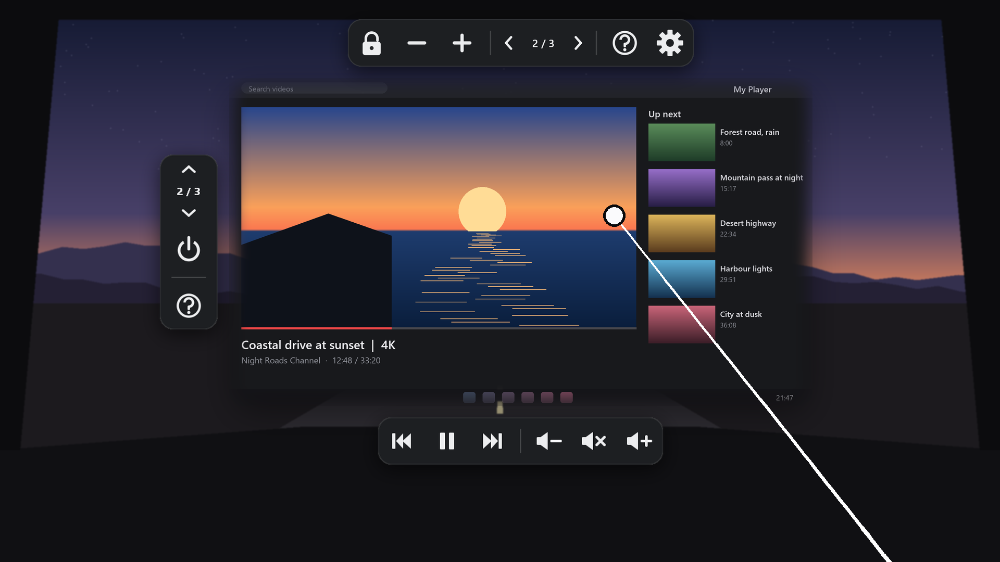
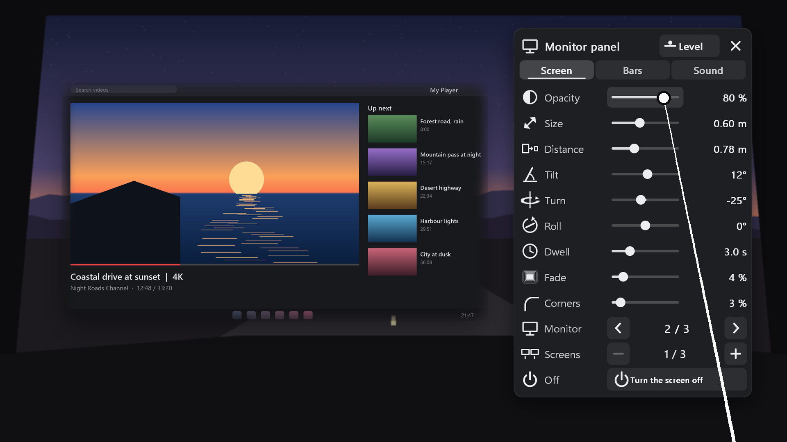
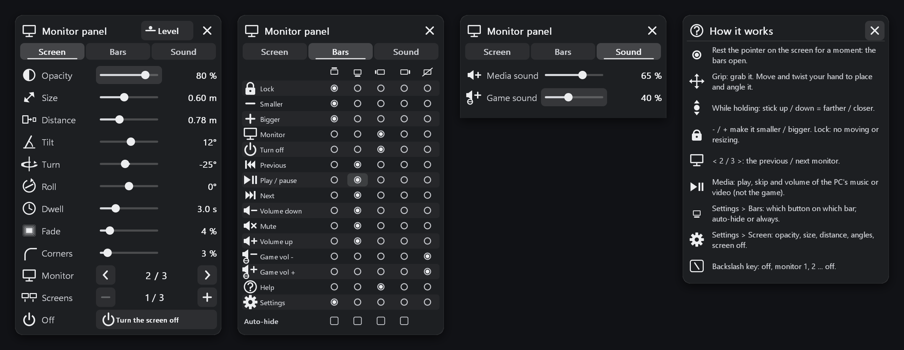

> [!CAUTION]
> ## THIS GITHUB PAGE IS THE ONLY PLACE THIS TOOL EXISTS
> **`https://github.com/JRDevo/Monitor-in-VR-Game` is the only place this tool is published, documented and downloaded
> (its [Releases](https://github.com/JRDevo/Monitor-in-VR-Game/releases) page).**
>
> - There is **no website** for this tool. No Discord, no Patreon, no Nexus, no Steam Workshop, no app store.
> - **DO NOT DOWNLOAD THIS TOOL FROM ANYWHERE ELSE.** Any other site, mirror, video link or forum attachment that offers
>   it is not mine and may carry anything. If it did not come from this GitHub page, do not run it.

# Monitor in VR Game — see your desktop monitor inside any OpenXR VR game

Shows one (or more) of your **desktop monitors live inside your VR game**, as a flat screen floating in front of you.
Watch YouTube, Twitch, a browser, Discord, a map or a guide **while you play in VR**, without taking the headset off and
without leaving the game. It has its own **VR controller pointer**: grab the screen, move it, twist it, make it bigger or
smaller, and use media buttons (play / pause, next, volume) right on the panel.

The game keeps focus and keeps every key. Nothing is clicked on your desktop, no window is opened, no overlay app runs.

**In short:** a free **desktop-in-VR overlay** for Windows, made as an **OpenXR API layer**. It works with **Meta Quest 3**
(Virtual Desktop or Link), **SteamVR** and any other OpenXR runtime, in **Direct3D 11 OpenXR games** — for example
**Euro Truck Simulator 2 / American Truck Simulator** in VR.

**Menu:** [Features](#features) · [Screenshots](#screenshots) · [Download](#-download) · [Requirements](#requirements) · [Install](#install) ·
[Controls](#vr-controls) · [Keys](#keys) · [Settings](#settings--configini) · [Limits](#limits) ·
[Troubleshooting](#reporting-a-problem-what-to-upload) · [License](#license)

## Features

- **Your monitor in VR, live** — any monitor of your PC, at its own resolution, up to 60 pictures a second.
- **Several screens** — show up to 8 monitors at once, each as its own panel.
- **VR controller pointer** — point at the screen, rest the pointer on it and the button bars open.
- **Grab, move and twist** — hold grip on a bar and the screen follows your hand; the stick pushes it away or pulls it closer.
- **Any size, any place** — 5 cm to 20 m wide, 10 cm to 50 m away, any angle; it stays where you put it.
- **Media buttons** — previous, play / pause, next, and volume for the media app only (never the game, never the master volume).
- **Game sound slider** — make the game quieter against your video, right from VR.
- **Settings page in VR** — opacity, size, distance, tilt, soft edges, rounded corners, which buttons go on which bar.
- **One key** — `Backslash` cycles hidden → monitor 1 → monitor 2 → … → hidden.
- **The game keeps focus** — the screen takes no clicks from the game; the game keeps every key and every button.
- **Sharp and light** — mip maps and soft edges, drawn at the size you see it; a still desktop costs no upload at all.
- **No window, no overlay app** — one OpenXR layer, added after the game's picture.
- **Works with [VR EyeCapture](https://github.com/JRDevo/VR-EyeCapture)** — the panel is recorded too.

## Screenshots

The menus are the tool's real pictures. The game and the desktop behind them are made up for these screenshots.

**The settings page next to the screen.** Point and pull the trigger to change a slider.

**Every page:** Screen, Bars (which button goes on which bar), Sound (media and game volume) and the help page.

## ⬇ Download

Get **`MonitorInVRGame-Setup-x.y.z.exe`** from the [Releases](https://github.com/JRDevo/Monitor-in-VR-Game/releases) page.

## Requirements

- Windows 10 or 11, 64-bit.
- A VR game that uses **OpenXR** and **Direct3D 11**.
- Any OpenXR runtime: Virtual Desktop (VDXR), SteamVR, Oculus / Meta Link, and others.
- Games that use only SteamVR's own API (OpenVR) do not work yet.

**Tested in:** American Truck Simulator (OpenXR beta) and Beat Saber. Other Direct3D 11 OpenXR games should work the
same way. Tried another game? Please tell me in an issue whether it works.

## Install

1. Close the game.
2. Run `MonitorInVRGame-Setup-x.y.z.exe`. Windows asks once for admin rights: the installer registers the OpenXR layer
   for all users.
3. Start the game in VR. The screen appears low and to the right, in front of where your head is at the start.

Your settings and the log are in `%LOCALAPPDATA%\Monitor in VR Game` (paste it into the Explorer address bar).
Remove it with **Settings > Apps > Monitor in VR Game > Uninstall**.

## VR controls

- **Point** at the screen: a dot shows where you point. The trigger on the picture goes to the **game**, as if the
  screen were not there.
- **Rest the pointer** on the picture for 3 s: a ring fills up, then the **bars** open. The top bar has lock, smaller /
  bigger, the monitor `< 2 / 3 >`, help and settings. The bottom bar has the media buttons.
- **Grip** on a bar: the screen hangs on your hand and follows it. The **stick** up / down pushes it away or pulls it closer.
- **Settings > Screen**: opacity, size, distance, tilt / turn / roll, the dwell time, soft edge and rounded corners,
  how many screens.
- **Settings > Bars**: put any button on any bar (top, bottom, left, right), or hide it; make each bar auto-hide or always shown.
- **Settings > Sound**: media sound and game sound, 0 to 100 %.
- Every change is saved in `config.ini`.

## Keys

| Key | Does |
| --- | --- |
| `Backslash` | cycles: hidden → monitor 1 → monitor 2 → … → hidden |

It acts only while the game's window is in front. Set `cycle_key = none` in `config.ini` for no key.

## Settings / config.ini

`%LOCALAPPDATA%\Monitor in VR Game\config.ini`. Changes apply within about 1 second, also while you play (`apps`, `controllers` and `log`: at the next game start).
Every key has a comment in the file. The default file is [docs/config.ini](docs/config.ini).

| Key | Default | Meaning |
| --- | --- | --- |
| `monitor` | `primary` | `primary`, a number (1 = first), part of a name (`DELL`), a list `1, 3`, or `all` |
| `show` | `1` | shown at the start |
| `cycle_key` | `Backslash` | the key that cycles the monitors; `none` = no key |
| `opacity` | `1` | 0.05 .. 1 |
| `fps_cap` | `60` | at most this many new pictures a second |
| `apps` | `*` | the games it works in: `*` = every OpenXR game, or exe names such as `amtrucks.exe, eurotrucks2.exe` |
| `controllers` | `1` | `0` = never touch the VR controllers |
| `pointer_smoothing` | `medium` | `off`, `low`, `medium`, `high` |
| `space` | `local` | `local` = in your room (VR controls work); `game` = fixed in the game's world, e.g. a truck cab |
| `lock` | `0` | `1` = the screen cannot be moved from VR |
| `log` | `1` | write the log file |

## Limits

- **DRM video is black** (Netflix, Prime and others with hardware DRM). Windows blanks it for every capture.
- **No clicking on the desktop from VR.** A click would take the focus from the game. Only the media buttons are sent.
- The mouse pointer is not drawn yet. HDR desktops and rotated monitors are not handled yet.
- A monitor on another GPU than the game's works, through a slower copy.
- Direct3D 11 OpenXR games only, for now.

## Reporting a problem (what to upload)

1. Make the problem happen once more, then close the game.
2. Paste `%LOCALAPPDATA%\Monitor in VR Game` into the Explorer address bar.
3. Open a [bug report](https://github.com/JRDevo/Monitor-in-VR-Game/issues/new/choose) and drag in
   `logs\monitor_in_vr_game.log` and `config.ini` (rename it to `config.txt`: GitHub does not take `.ini` files).

**Privacy:** the log contains folder paths with your Windows user name. Open it and check before uploading.

## License

Free for noncommercial use: [PolyForm Noncommercial 1.0.0](LICENSE.md). Third-party parts: [THIRD_PARTY.md](THIRD_PARTY.md).

---

*Keywords: desktop in VR, monitor in VR, second screen in VR game, watch YouTube in VR while gaming, browser in VR game,
OpenXR overlay, OpenXR API layer, Quest 3, Virtual Desktop, SteamVR, Euro Truck Simulator 2 VR, American Truck Simulator VR,
Beat Saber,
sim racing overlay, virtual screen, VR desktop overlay, desktop capture, Windows.*
